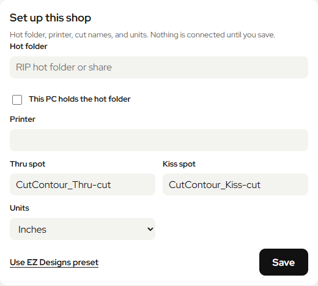
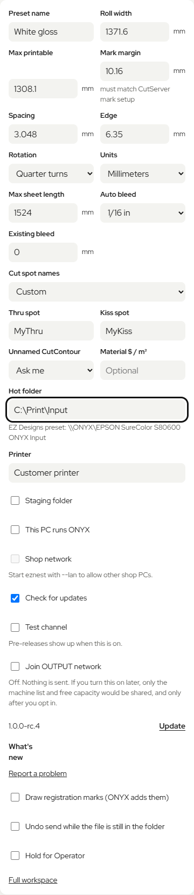

# Ez Nest

Ez Nest nests a print job on one shop computer and writes the finished file to a RIP hot folder. Designers use a browser. They do not install Ez Nest.

The shop host is a 64-bit PC running Windows 10 or Windows 11. Each designer PC only needs a browser. A RIP such as ONYX is optional. **Use Example shop preset** fills placeholder printer, cut names, and hot-folder paths that you replace with your own. The host does not need an Adobe account. A designer can drop in a PDF prepared in Illustrator. Width comes from the material. Length comes from the layout.

**Install.** On the host, download `eznest-setup.exe` and run it. It installs to `C:\Program Files\eznest`. During beta the installer is unsigned. If Windows SmartScreen appears, choose **More info**, then **Run anyway**, after you check the published `.sha256`. The steps are under [Install](#install) and [Windows warning screen](#windows-warning-screen).

**Stock database.** `materials.sqlite3` stays on the host. Only the Ez Nest process on that PC may open it. Do not put it on an SMB share or copy it to a designer PC.

**Shop network.** The page stays on the host at `http://127.0.0.1:8765/web` until you set a shop PIN and turn Shop network on. Other computers then open `http://SHOP-HOST:8765/web` and enter that PIN once. The default is plain HTTP on port 8765. Anyone who can watch that LAN can copy a signed-in browser's session cookie. Local HTTPS is the recommended extra step. See [Security](SECURITY.md). Use a trusted private network. The installer firewall rule is the Private profile only, limited to the local subnet or the designer PC addresses you pass in. Keep port 8765 off the internet.

**Uninstall.** Uninstall removes the program, the startup task, the `eznest-svc` account, and the firewall rule. `%ProgramData%\eznest` stays on the host, including `materials.sqlite3`. The RIP hot folder stays too. Details are under [Uninstall](#uninstall).

**Data stays in the shop.** Artwork, nest files, and stock records stay on the host. OUTPUT sharing is optional and off by default. A send to OUTPUT needs a shop key (from a pairing code on the host, or from launch settings) and **Enable sharing** on that host. See [OUTPUT pairing](docs/output-pairing.md).

**Trademark.** Ez Nest is a project of EZ Designs. The software is [Apache-2.0](LICENSE). Third-party notices stay in [THIRD_PARTY.md](THIRD_PARTY.md) and `licenses/`.

**1.0.0-rc.5** is the shop release candidate.

[Designer quick start](docs/employee-quick-start.md) · [Host updates and rollout checks](docs/windows-updates.md) · [Security](SECURITY.md) · [Code of conduct](CODE_OF_CONDUCT.md) · [Contributing](CONTRIBUTING.md)

## Install

One Windows PC runs Ez Nest. The other computers only open a browser. The shop PC does not need Python or Git.

1. Download `eznest-setup.exe` from the GitHub release, or from the Windows installer artifact if you are testing a build that is not released yet. Code → Download ZIP is source, not the app.
2. If `eznest-setup.exe.sha256` is beside it, compare that checksum with the file before you run it.
3. Close any older Ez Nest, including a build still using port 8765. `Stop EZ Nest.cmd` in the old folder does that.
4. Run `eznest-setup.exe`. It installs to `C:\Program Files\eznest` and adds a desktop shortcut.
5. Leave **Start eznest when Windows starts** on if this PC should be ready after a reboot. That task is named `eznest`. It runs as the local user `eznest-svc`, which is not an administrator. The task uses limited rights. The password is random and is not written into the Ez Nest folder.
6. Leave **Shop network** off unless other PCs on this network will open the page. Leave **Check for app updates** unchecked. Update checks stay off until you also start Ez Nest with `EZ_NEST_UPDATES=1` and turn **Check for updates** on in Settings. See [Update](#update).

The desktop shortcut opens the browser. The boot task does not. Closing the browser leaves Ez Nest running. `Stop EZ Nest.cmd` in the install folder stops it.

Settings and the hot-folder path for an installed copy live in `%ProgramData%\eznest`.

To build the installer on a Windows machine instead, install 64-bit Python 3.12 and [Inno Setup 6](https://jrsoftware.org/isinfo.php):

```powershell
py -3.12 -m pip install -r requirements.txt -r requirements-build.txt
py -3.12 build_windows.py --out ..\eznest-build
```

The result is `installer\Output\eznest-setup.exe`. The version number comes from `version.json`.

## Uninstall

Uninstall eznest from Windows Settings, or run the uninstaller in `C:\Program Files\eznest`.

That removes the program, the shortcuts the installer created, the `eznest` startup task, and the firewall rule named `eznest`. It removes the local user `eznest-svc` when Windows allows it. If that account is still signed in, uninstall disables the account instead. It also removes that account's permissions on `%ProgramData%\eznest` and on a local hot-folder path saved in `output-folder.json`.

`%ProgramData%\eznest\materials.sqlite3` stays on the host with the rest of that folder: shop settings, local activity, and a paired OUTPUT credential file if one was saved. `installer/uninstall-shop.ps1` leaves shop files in the data folder. `installer/eznest.iss` runs that script and has no step that deletes `{commonappdata}\eznest`. The RIP hot folder and the files already in it stay.

## First run

The first time the page opens, it asks for four things:

- Hot folder, the RIP folder a save writes to
- Printer name
- Cut spot names, thru and kiss
- Units

**Use Example shop preset** fills placeholder values: Example printer, CutContour thru and kiss names, inches, and example hot-folder paths. Check **This PC holds the hot folder** when the folder is on this computer, and the preset uses `C:\RIP\Example RIP Input`. Leave it off and the preset uses `\\RIP\Example RIP Input`. You can type a different path. Nothing is connected until you save.

After that, the page is one screen. Drop the day's files, set the quantity, choose **Review and save**, then **Save**.

| File | What Ez Nest needs |
| --- | --- |
| PDF | Closed cut strokes it can map, and a closed outer boundary for each piece. |
| AI | The same, saved with Create PDF Compatible File. If it cannot be read, the page says Save as PDF. |
| SVG | A grouped piece with a clipping outline, a cut contour, or a path named `EZN_BOUNDARY`. |

PDF and SVG do not share a batch. One batch holds 800 pieces. Width is the material. Length comes from the layout.

If the save cannot see the hot folder or the share, the page says so and does not pretend the job was sent. Check the path, and that this PC can open the share. A hot folder on another PC is a share. This installer cannot change that share's permissions. On the RIP PC, the account that runs Ez Nest needs write access to the folder.

Leave colors as they are in the file. Set the printer ICC and registration marks in the RIP.

## Windows warning screen

During beta, `eznest-setup.exe` is unsigned. Windows SmartScreen can say it protected your PC.

1. Download `eznest-setup.exe` and the published `eznest-setup.exe.sha256` beside it.
2. Compare that checksum with the file before you run it. A mismatch means do not run the file.
3. If SmartScreen appears, choose **More info**, then **Run anyway**.

That screen is the unsigned-beta warning. It is not Ez Nest's own check. When update checks are on, a downloaded installer is kept only when its SHA-256 matches the published checksum, and installing it is still a separate click.

## Update

**Update** is in Settings, with **What's new** and **Report a problem**.

Background update checks are **off** during beta. Ez Nest does not call GitHub, and does not read an update token, until both of these are true:

1. Settings → App updates → **Check for updates**. That stores `"updates": true` in `shop.json`.
2. The process that starts Ez Nest has `EZ_NEST_UPDATES=1`. The default, when the variable is unset, is off (`0`).

The installer task **Check for app updates** only saves the Settings preference. You still set `EZ_NEST_UPDATES=1` for the account that runs Ez Nest, then restart. `--shop-test` forces checks off.

When both are on, Ez Nest looks for a newer release at startup and every six hours. It downloads an installer only when the SHA-256 checksum matches. For signed Program Files installations, **Install when finished** opens a separate helper and asks for Windows administrator approval. It waits for the current job to be sent or explicitly discarded, then installs and restarts the existing limited `eznest-svc` task. A failed startup restores the previous files. Settings, local activity and hot-folder contents stay in their existing locations.

Unsigned builds still require a manual installer upgrade. The managed helper requires a signed app and installer from the same certificate, the default data directory/port, and an existing limited startup task. See [update testing and recovery](docs/windows-updates.md).

Pre-releases show up only when **Test channel** is on.

A public repository needs no token. For a private-repo mirror, set `EZ_NEST_GITHUB_TOKEN` on the process that runs Ez Nest, or on Windows store a generic credential named `eznest/github-token`. A token in `shop.json` or a `github-token` file is ignored. Delete an old `github-token` file if one is still in the data folder. The token is sent only to GitHub, and only while update checks are on. The release URL and the problem-report link can be changed without rebuilding. See [Contributing](CONTRIBUTING.md).

## Report a problem

**Report a problem** in the gear opens a GitHub issue with the version filled in. Write what you clicked and the words on screen. Do not attach customer artwork.

If an update rolled back, include `helper.log` and leave customer files out of it.

## Privacy and telemetry

Artwork, nests, and stock records stay on the shop host. Remote sharing is optional and **off** until the host opts in. Nesting, previewing, and saving a file do not send anything.

A send to OUTPUT needs both a shop credential (a pairing code on the host, or `EZ_NEST_OUTPUT_UPLOADS=1` with `EZ_NEST_OUTPUT_TOKEN`) and **Enable sharing** after the on-screen agreement. `EZ_NEST_OUTPUT_UPLOADS=0`, including `--shop-test`, turns delivery off. **Stop sharing** or disconnect stops later sends. It does not delete records the service already accepted.

The consented payload is the `eznest-observation/1` projection described in [OUTPUT sharing](docs/output-telemetry.md). The local proposal, which is not itself uploaded, is in [the telemetry contract](docs/telemetry-contract.md). A consented event can include:

- a stable installation id, opaque layout and request ids, event time, app version, and event type
- a standard material category: `moto_regular`, `moto_holographic`, `moto_chrome`, `custom`, `unknown`, or null
- measurement bands for length, width, area, unused printable percent, piece count, sheet count, search time, and stock ranges

The host IP address and the shop credential go with those HTTPS requests. Exact quantities stay on the host.

Never sent: artwork, files, filenames, customer names or contacts, job codes, roll ids, custom material names, or exact dimensions, quantities, stock, and search time.

The default OUTPUT service is `https://output.jeezlabs.io` (`/api/shop/telemetry` for events and `/api/shop/agent/pair` for pairing). Change the saved address only on the shop computer. It must be `https://output.jeezlabs.io`, or the exact https origin in `EZ_NEST_OUTPUT_URL` set before Ez Nest starts. The environment variable wins. The value must be an `https` origin with no path, query, username, or password. Redirects are not followed. Changing the address does not turn sharing on.

## Shop network

The default is this computer only: `http://127.0.0.1:8765/web`.

Shop network stays closed until a shop PIN is set on this computer and you start with `--lan`. The page is plain HTTP. Designer browsers enter the PIN once. They do not receive the host write token. Do not share this network with guest WiFi. Do not forward port 8765 to the internet. See [Security](SECURITY.md).

1. On the shop computer, open Settings → **Shop PIN**. Enter 8 to 12 digits, or a passphrase of at least 10 characters with a letter, and save it. An older shorter PIN still signs in. Settings asks you to replace it.
2. Choose Shop network in the installer (which adds `--lan` to the boot task), or start the app with `--lan`. `--lan` does not open the network until the PIN is saved. The gear reports the running mode.
3. Restart Ez Nest. The gear then shows `http://<this-computer>:8765/web`. Other PCs open that address and enter the PIN. They choose **Log out** when finished. A session ends after 60 idle minutes, after 8 hours, or when the address changes. They do not install Ez Nest.
4. The installer opens Windows Firewall for TCP 8765 on the private profile only, for `localsubnet` or the designer PC addresses in `-LanPeers`. It does not open a public profile.
5. Recommended: create a certificate and start with `--tls-cert` and `--tls-key` (or `-TlsCert` and `-TlsKey` on `install-shop.ps1`). Designers then use `https://`. The commands are in [Security](SECURITY.md). HTTP remains the default when those are omitted. On HTTP, a person who can watch the shop LAN can copy a session cookie and reuse it until it expires.

Only `--lan` opens a non-loopback listener, and only after the PIN exists. A saved preference alone cannot open it.

`materials.sqlite3` stays on this computer. The host process is the only program that should open it. Do not put that file on a shared drive or an SMB share.

## OUTPUT

OUTPUT sharing is optional and off by default. On the host, **Share activity with OUTPUT** accepts a pairing code and then requires **Enable sharing**. Nesting and hot-folder delivery stay on the shop PC either way. Customer artwork stays on the host. See [OUTPUT pairing](docs/output-pairing.md).

The separate **Join OUTPUT network** control is not that consent. It stays off, and its status says nothing is sent. The service address is documented under [Privacy and telemetry](#privacy-and-telemetry).

## Limits

One material and up to 800 pieces. PDF import is 2 GB and 25 pages. No EPS, no DeviceN cut colors, no inventory, and no direct printer or cutter control. Nesting is heuristic. Read [supported files](docs/PRODUCTION-FILES.md).

Not in v1: job history, order intake, and cost tracking as a product.

## Nesting benchmark

`tools/nest_bench.py` runs a fixed set of jobs through the shop nesting entry
point and records roll length, utilization, wasted area, wall time, seed, and
an exact all-pairs gap check. The outlines live in
`tools/fixtures/nest_outlines.json`. Results and the iteration log are in
[the nesting benchmark notes](docs/nesting-benchmark.md).

```bash
python tools/nest_bench.py --out tools/fixtures/nest_bench_baseline.json
python tools/nest_bench.py --compare tools/fixtures/nest_bench_baseline.json new.json
```

Compare exits with an error when any case uses more than 0.3% extra length,
loses more than 0.3% utilization, or fails validation. It does not call the
network.

## Develop

Contributing, tests, and the version source are in [CONTRIBUTING.md](CONTRIBUTING.md).

From source, with 64-bit Python 3.12:

```powershell
py -3.12 -m venv .local/venv
.local/venv/Scripts/python.exe -m pip install -r requirements.txt
.local/venv/Scripts/python.exe launcher.py --web
```

On Linux or macOS, use `python3` and `.local/venv/bin/python`. Then open `http://127.0.0.1:8765/web`.

```bash
docker build -t eznest .
docker run --rm -p 8765:8765 eznest
```

### Illustrator pilot

The [Illustrator pilot](illustrator/START%20HERE.txt) runs on the same PC as Ez Nest. Run `illustrator/Nest in eznest.jsx` through Illustrator's
File > Scripts > Other Script. It exports a separate
production copy using your chosen Adobe PDF preset and opens a local handoff.
The first run remembers the PDF preset, material, width and existing bleed;
later runs load an empty workspace automatically. Choose sets, review and send.
Run `EZ Nest Settings.jsx` to change saved choices. An existing job requires
explicit replacement. See the pilot guide to add the script to Illustrator's menu.
The pilot uses `print`, `thru-cut`, and `kiss cut` layers and Regular material.
Use a test hot folder first. Live Illustrator host and ONYX validation are still
required; automated bridge tests do not establish physical production readiness.

## License

Ez Nest is Apache-2.0. See [LICENSE](LICENSE) and [NOTICE](NOTICE). Ez Nest is a project of EZ Designs. Dependencies keep their own licenses. See [THIRD_PARTY.md](THIRD_PARTY.md) and `licenses/`.


## Setup preview





### Saved materials in the simple browser page

Use the material buttons below the preview. **Custom** creates a named preset;
**Edit** in the Material row changes the selected roll. Save the roll width, printable width,
spacing and edge clearance together. Enter the length left on a roll if known;
update it after actual printing. Preparing a file never deducts stock. Presets
stay in this browser. Chrome and Holographic are names for already prepared art,
not automatic specialty color preparation. App settings remain in the top-right
Settings corner.

### Separate local trial

`launcher.py --shop-test` starts a separate local trial with TEST output, update checks off, and OUTPUT delivery off. It refuses an occupied port and does not adopt an existing unmarked data folder. `Prepare and Nest.jsx` is the short-flow entry point for the Illustrator production-copy export. It does not add recoloring or bleed generation. Physical print and cut acceptance remains an operator test.
